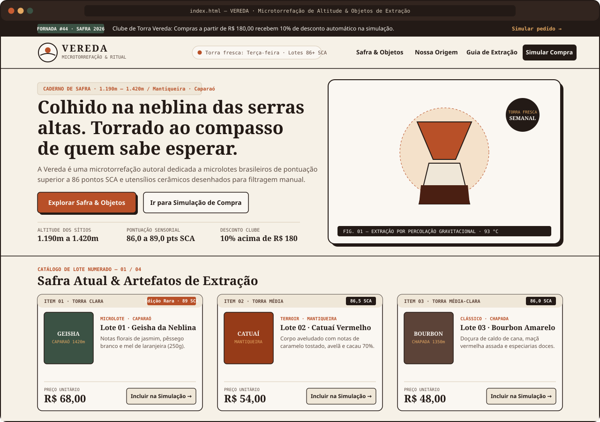

# VEREDA - Microtorrefação de Altitude & Objetos de Extração



---

## 1. Apresentação

- **Nome do projeto:** VEREDA - Microtorrefação de Altitude & Objetos de Extração
- **Nome do aluno:** João José Penha Sousa
- **Trilha:** Desenvolvimento Mobile
- **Descrição geral do projeto:**  
  A **VEREDA** é uma loja virtual fictícia voltada para cafés especiais brasileiros e acessórios de preparo filtrado, desenvolvida utilizando **HTML5**, **CSS3** e **JavaScript puro**. O projeto apresenta o catálogo de grãos e utensílios da marca e conta com um simulador de compras interativo que utiliza `prompt()` e `alert()` para coletar as quantidades desejadas, validar os dados informados pelo usuário, formatar os valores em Real (`R$`) e aplicar desconto automático conforme o valor do pedido.

---

## 2. Identidade da Loja

- **Nome da marca:** **VEREDA** - Microtorrefação & Ritual
- **Slogan:** *“Da neblina da serra ao compasso da sua xícara.”*
- **Segmento:** Cafés especiais brasileiros em microlotes (pontuação 86+ SCA) e acessórios para extração manual.
- **Conceito e posicionamento:**  
  Inspirada nas regiões produtoras de Minas Gerais, Espírito Santo, Bahia e São Paulo, a loja busca valorizar o preparo do café coado com calma, destacando a origem dos grãos, a altitude das lavouras e o processo de torra fresca.
- **Público-alvo:**  
  Consumidores de cafés especiais, estudantes, profissionais que apreciam café coado no dia a dia e pessoas que buscam produtos de pequenos produtores.
- **Proposta comercial e diferencial:**  
  Trabalhar com cafés de quatro regiões tradicionais (Serra do Caparaó, Mantiqueira de Minas, Chapada Diamantina e Alta Mogiana), realizados em torras semanais de pequenos lotes, além de oferecer utensílios duráveis em cerâmica e inox.
- **Direção visual e paleta de cores:**
  - **Variáveis CSS (`:root`):**
    - `--cor-principal`: `#231A16`
    - `--cor-secundaria`: `#5C4338`
    - `--cor-destaque`: `#B85028`
    - `--cor-fundo`: `#F6F1E7`
    - `--cor-superficie`: `#EFE7D8`
    - `--cor-texto-principal`: `#231A16`
    - `--cor-texto-secundario`: `#5E4E45`
  - **Tipografia:** Fontes serifadas para os títulos (`Georgia` / `Palatino Linotype`), sem-serifa para os textos corridos (`Segoe UI` / `system-ui`) e fonte monoespaçada (`Consolas`) para detalhes técnicos e resumo do pedido.

---

## 3. Catálogo de Produtos e Regra de Desconto

Abaixo estão os 6 produtos disponíveis no catálogo da loja e utilizados na simulação de compra:

| Item | Produto | Categoria / Origem | Descrição | Preço Unitário |
| :---: | :--- | :--- | :--- | :---: |
| **01** | **Lote 01 · Geisha da Neblina (250g)** | Microlote · Serra do Caparaó (1.420m) | Fermentação lenta em clima frio de montanha. Notas florais de jasmim, pêssego branco e mel de laranjeira. | **R$ 68,00** |
| **02** | **Lote 02 · Catuaí Vermelho Natural (250g)** | Terroir · Mantiqueira de Minas (1.280m) | Secagem em terreiro suspenso. Corpo aveludado com notas de caramelo tostado, avelã e cacau 70%. | **R$ 54,00** |
| **03** | **Lote 03 · Bourbon Amarelo Lavado (250g)** | Clássico · Chapada Diamantina (1.350m) | Cereja descascado lavado em água de nascente. Doçura de caldo de cana, maçã vermelha assada e especiarias doces. | **R$ 48,00** |
| **04** | **Lote 04 · Arara Mel de Engenho (250g)** | Experimental · Alta Mogiana (1.190m) | Secagem *honey* com mucilagem preservada. Notas de rapadura, tangerina madura e amêndoas. | **R$ 62,00** |
| **05** | **Objeto 05 · Coador Vértice em Cerâmica** | Artefato · Grés Queimado a 1.280 °C | Modelado em argila tabaco com nervuras espirais internas que ajudam na estabilidade térmica e no fluxo da água. | **R$ 135,00** |
| **06** | **Objeto 06 · Chaleira Bico de Ganso Âmbar (600ml)** | Instrumento · Aço Inox 304 Escovado | Bico fino para controle do despejo de água, termômetro analógico na tampa e cabo em madeira. | **R$ 210,00** |

### Regra de Desconto (Clube de Torra Vereda)
- **Condição:** Compras com subtotal igual ou superior a **R$ 180,00** recebem **10% de desconto** no valor total.
- **Compras abaixo de R$ 180,00:** Não possuem desconto, mantendo o valor normal dos itens e mostrando no resumo quanto faltou para alcançar o benefício.

---

## 4. Tecnologias Utilizadas

- **HTML5:**  
  Estruturação da página com tags semânticas (`<header>`, `<nav>`, `<main>`, `<section>`, `<article>`, `<aside>`, `<footer>`), textos alternativos (`alt`) nas imagens e atributos básicos de acessibilidade.
- **CSS3:**  
  Uso de variáveis no `:root` para organizar as cores e espaçamentos, layout responsivo com **Flexbox** e **CSS Grid**, estilização de botões e cards com efeitos de `:hover` e adaptação para telas menores com `@media`.
- **JavaScript (ES6+):**  
  Lógica da simulação de compras usando `prompt()` e `alert()`, conversão de tipos com `Number()`, validação de números inteiros positivos, formatação de moeda em Real com `toLocaleString('pt-BR', { style: 'currency', currency: 'BRL' })`, filtro de categorias no catálogo e abertura do menu mobile.

---

## 5. Estrutura do Projeto

```text
Desafio_trilhas/
│
├── index.html                     # Página principal da loja
├── style.css                      # Estilos da página e responsividade
├── script.js                      # Lógica da simulação de compra e interações
├── README.md                      # Documentação do projeto
│
└── assets/                        # Imagens em SVG utilizadas na página
    ├── logo-vereda.svg
    ├── hero-extracao.svg
    ├── produto-01-geisha.svg
    ├── produto-02-catuai.svg
    ├── produto-03-bourbon.svg
    ├── produto-04-arara.svg
    ├── produto-05-coador.svg
    ├── produto-06-chaleira.svg
    └── screenshot-loja.svg
```

---

## 6. Como Executar o Projeto Localmente

1. **Clone este repositório:**
   ```bash
   git clone <URL_DO_SEU_REPOSITORIO>
   ```
2. **Acesse a pasta do projeto:**
   ```bash
   cd Desafio_trilhas
   ```
3. **Abra o arquivo `index.html` no navegador:**
   - Dê dois cliques no arquivo `index.html` na pasta do projeto, ou abra utilizando a extensão *Live Server* do VS Code.
4. **Teste a simulação de compra:**
   - Role até a seção **Simulador de Compra** (ou clique no botão do topo) e clique em **"Simular compra"**.

---

## 7. Testes Realizados

Os testes abaixo foram feitos diretamente no navegador para verificar as validações e os cálculos do `script.js`:

| Nº | Cenário de Teste | Entradas Informadas no `prompt()` | Resultado Obtido | Status |
| :---: | :--- | :--- | :--- | :---: |
| **1** | **Compra de um único produto** | `1` no 1º produto (Geisha) e `0` nos outros 5 produtos | Calculou 1x *Geisha da Neblina* (`R$ 68,00`), informou que não houve desconto e exibiu `TOTAL DA COMPRA: R$ 68,00` no `alert()`. | Aprovado |
| **2** | **Compra de vários produtos** | `1` no Lote 01, `1` no Lote 02, `1` no Lote 04 e `0` nos demais | Somou `R$ 68,00 + R$ 54,00 + R$ 62,00 = R$ 184,00`, aplicou os 10% de desconto (`- R$ 18,40`) e exibiu `TOTAL DA COMPRA: R$ 165,60`. | Aprovado |
| **3** | **Quantidade zero para um produto** | `0` no 1º, `2` no 2º (Catuaí), `1` no 4º (Arara) e `0` nos restantes | Não listou os itens com quantidade `0` no resumo, mostrando apenas os escolhidos (total de `R$ 170,00`). | Aprovado |
| **4** | **Todas as quantidades iguais a zero** | `0` em todos os 6 produtos | Não gerou recibo zerado e exibiu o alerta `"Nenhum produto foi selecionado."`. | Aprovado |
| **5** | **Quantidade negativa** | `-2` no 1º produto; depois corrigido para `1` e `0` nos demais | Mostrou alerta de valor inválido para `-2`, repetiu a pergunta do mesmo item e continuou normalmente após digitar `1`. | Aprovado |
| **6** | **Entrada com texto, vazia ou número decimal** | `"abc"`, campo vazio e `"1.5"` no 1º item; depois `2` e `0` nos demais | Recusou cada entrada inválida pedindo o valor novamente e só avançou ao informar o número inteiro `2`. | Aprovado |
| **7** | **Cancelamento durante a simulação** | `1` nos dois primeiros itens e clique em *Cancelar* no 3º produto | Parou o loop na hora e exibiu a mensagem `"Simulação de compra cancelada pelo usuário."`. | Aprovado |
| **8** | **Compra com direito ao desconto** | `1` na Chaleira Bico de Ganso (6º item) e `0` nos demais | Como `R$ 210,00` passa de `R$ 180,00`, aplicou 10% de desconto (`- R$ 21,00`), fechando em `R$ 189,00`. | Aprovado |
| **9** | **Compra sem direito ao desconto** | `1` no Coador Vértice (5º item) e `0` nos demais | Manteve o valor integral de `R$ 135,00` e indicou que faltaram `R$ 45,00` para alcançar o desconto. | Aprovado |

---

## 8. Dificuldades Encontradas e Aprendizados

Durante a criação da validação de quantidades no `script.js`, tive um problema com a forma como o `Number()` funciona no JavaScript:

- **O problema:** Quando eu deixava o campo do `prompt()` vazio (`""`) ou só com espaços e clicava em *OK*, o `Number("")` convertia isso automaticamente para `0`. O mesmo acontecia se não verificasse o botão *Cancelar* antes, pois `Number(null)` também vira `0`. Com isso, apertar *OK* sem digitar nada acabava passando na validação como se o usuário tivesse digitado zero.
- **Como resolvi:**  
  1. Antes de converter para número, coloquei um `if (respostaBruta === null)` para checar se a pessoa clicou em *Cancelar* e encerrar a função na hora.  
  2. Depois usei `.trim()` para tirar espaços em branco e verifiquei se a string ficou vazia (`textoLimpo === ""`), mostrando um aviso para o usuário digitar `0` caso não queira o item.  
  3. Só depois disso faço a conversão com `Number(textoLimpo)` e checo se é um inteiro positivo com `Number.isInteger()` e `quantidade >= 0`.

---

## 9. Utilização de Inteligência Artificial

- **Como a IA auxiliou no desenvolvimento:**  
  Utilizei a IA como apoio para gerar as imagens vetoriais (SVG) dos pacotes de café e utensílios na pasta `assets/`, ajudar na escolha da paleta de cores e textos descritivos dos cafés, além de tirar dúvidas sobre validação de dados no JavaScript.
- **Partes geradas e adaptadas:**  
  As ilustrações em SVG e sugestões na estruturação do layout em CSS Grid foram geradas com auxílio da ferramenta e depois ajustadas para encaixar nas regras da atividade e manter os mesmos preços e nomes entre o HTML e o `script.js`.
- **Como o funcionamento foi verificado:**  
  Testei manualmente pelo navegador todas as situações pedidas no desafio (compra de 1 ou mais itens, cálculo dos 10% de desconto para compras a partir de R$ 180,00, todas as quantidades iguais a zero, tentativa de digitar letras, números negativos, decimais, campo em branco e clique no botão Cancelar), além de conferir a visualização em tela de celular e desktop pelo inspecionar elemento (DevTools).
- **Aprendizados consolidados:**  
  Prática com manipulação de eventos no DOM, funcionamento da conversão de tipos com `Number()`, tratamento de erros de entrada no `prompt()`, formatação de moeda com `toLocaleString()` e organização de layouts responsivos com CSS Grid e Flexbox.
